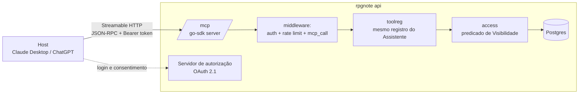
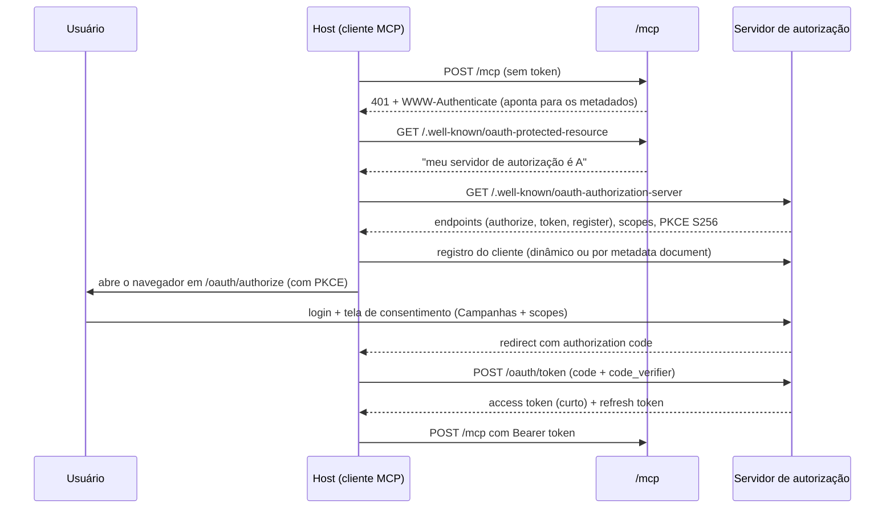

# MCP no RPG Note

Este documento explica **como e por que** o RPG Note expõe um servidor MCP (Fase 2, ADR 0005), além de como medimos o uso dele. Ele também serve de material de estudo.

## 1. O que é o MCP

O **Model Context Protocol** é um protocolo aberto que padroniza como aplicações de IA se conectam a fontes de dados e ferramentas. Antes dele, cada app de IA precisava de uma integração própria com cada serviço. Com ele, um servidor MCP funciona em qualquer cliente que fale o protocolo.

### Papéis

| Papel | No nosso caso |
|---|---|
| **Host** | O app de IA que o usuário usa: Claude Desktop, Claude.ai, ChatGPT, Cursor |
| **Cliente** | O componente dentro do host que mantém a conexão com um servidor |
| **Servidor** | **O RPG Note**, em `https://<domínio>/mcp` |

As mensagens seguem **JSON-RPC 2.0**. A conexão começa com `initialize`: o cliente informa quem é (`clientInfo`: nome e versão) e o que suporta, e o servidor responde com as suas capacidades.

### As três primitivas

| Primitiva | Quem decide usar | Exemplo no RPG Note |
|---|---|---|
| **Tools** | **O modelo** decide chamar | `search_notes("vilão de capuz")` |
| **Resources** | **O usuário ou o host** anexa ao contexto | `rpgnote://campaign/42/session/7` |
| **Prompts** | **O usuário** escolhe num menu | "Preparar próxima sessão" |

A diferença entre elas é **quem controla**, e isso define o que cada uma deve fazer. Uma Tool é uma ação que o modelo dispara por conta própria. Um Resource é um dado que o usuário escolhe dar ao modelo. Um Prompt é um atalho de fluxo que o usuário dispara.

## 2. Por que o MCP dá valor ao produto

1. **"Traga sua própria IA".** O usuário conversa com as Notas da campanha no Claude ou no ChatGPT que já assina, e o custo de LLM é **dele**, não nosso. Isso permite um plano gratuito generoso sem prejuízo.
2. **O Mestre prepara a sessão onde já trabalha.** No Claude Desktop, ele pede "monte a próxima sessão considerando as pistas que os jogadores ainda não seguiram" com o contexto completo da Campanha e, com `notes:write`, salva o resultado como Nota.
3. **Integrações sem esforço nosso.** Qualquer cliente MCP vira uma interface do RPG Note: bots de Discord, assistentes de voz, editores.
4. **Dados de produto.** O rastreamento mostra quais ferramentas e clientes são usados de verdade, e isso orienta o que construir dentro do app.
5. **Diferencial comercial.** "Funciona com o seu Claude" é um argumento de venda, e o MCP gratuito é uma porta de entrada para o plano pago (que inclui o Assistente embutido).

As métricas da seção 6 dizem se essas hipóteses se confirmam.

## 3. Arquitetura



- **Transporte: Streamable HTTP.** Um endpoint único (`/mcp`) recebe `POST` com mensagens JSON-RPC e pode responder em JSON ou abrir um stream SSE quando a resposta é longa. É o transporte para servidores remotos. O outro transporte, `stdio`, serve para servidores locais e não se aplica aqui.
- **Mesmo binário, mesmo registro.** O `/mcp` é só mais uma porta de entrada para o `toolreg`. A regra de acesso está no registro e no `access`, nunca no loop do Assistente. Por isso o MCP herda a Visibilidade sem código novo.
- **SDK:** `modelcontextprotocol/go-sdk`, que cuida do JSON-RPC, da sessão MCP e do transporte. Nós registramos Tools, Resources e Prompts e implementamos os handlers.

## 4. Autorização (OAuth 2.1)

A especificação do MCP define que um servidor remoto protegido usa **OAuth 2.1**. O RPG Note faz os dois papéis: **servidor de recurso** (o `/mcp`) e **servidor de autorização** (emite os tokens). O login do usuário continua sendo o do ADR 0002 (Google, Discord ou link mágico).

### Passo a passo da conexão



Detalhes importantes:
- **PKCE (S256) é obrigatório.** Impede que um código de autorização interceptado seja trocado por token.
- **Registro do cliente.** Os hosts não estão cadastrados conosco de antemão. A especificação prevê o *Dynamic Client Registration* (o cliente se registra sozinho em `/oauth/register`), e versões recentes também preveem o *Client ID Metadata Document* (o `client_id` é uma URL com os metadados do cliente). Suportar os dois, conferindo a versão da especificação na implementação.
- **Audience.** O token é emitido **para o recurso `/mcp`** (parâmetro `resource`, RFC 8707), e o servidor rejeita tokens emitidos para outro recurso. O RPG Note **nunca** repassa o token do usuário para outro serviço.
- **Tela de consentimento.** Mostra o nome do app conectado, os scopes (`notes:read`, `notes:write`) e a **lista de Campanhas** com caixas de seleção. O acesso efetivo de um token é: *o que o usuário pode ler* ∩ *as Campanhas autorizadas para esse app*.
- **Tokens**: access token de curta duração (ex.: 1h), refresh token rotativo. No banco ficam só os **hashes** (`oauth_token`).
- **Revogação**: "Apps conectados" → Revogar apaga o `oauth_grant` e invalida os tokens na hora.

## 5. Catálogo

### Tools

| Tool | Scope | Descrição para o modelo | Entrada |
|---|---|---|---|
| `list_campaigns` | `notes:read` | Lista as Campanhas autorizadas | — |
| `search_notes` | `notes:read` | Busca híbrida nas Notas legíveis (o mesmo RAG do Assistente) | `campaign_id`, `query`, `session_number?`, `limit?` |
| `get_note` | `notes:read` | Nota completa | `note_id` |
| `get_character_sheet` | `notes:read` | Ficha com valores calculados e Estado | `sheet_id` |
| `list_sessions` | `notes:read` | Sessões de uma Campanha | `campaign_id` |
| `get_session_recap` | `notes:read` | O Resumo **do usuário** para a Sessão (gera se necessário, e isso consome a cota de IA dele) | `campaign_id`, `session_number` |
| `create_note` | `notes:write` | Cria uma Nota, **privada por padrão** | `campaign_id`, `title`, `content`, `session_number?`, `visibility?` |
| `update_sheet_state` | `notes:write` | Altera o Estado de uma Ficha (respeitando RN-04) | `sheet_id`, `changes` |

As Tools de escrita entram depois das de leitura, ainda na Fase 2. Cada Tool declara `annotations` (`readOnlyHint`, `destructiveHint`), e com isso o host decide quando pedir confirmação ao usuário.

### Resources

| URI | Conteúdo |
|---|---|
| `rpgnote://campaign/{campaign_id}` | Visão geral: Mestres, Jogadores, Sessões, link da chamada |
| `rpgnote://campaign/{campaign_id}/session/{number}` | Notas legíveis da Sessão, concatenadas |
| `rpgnote://note/{note_id}` | Uma Nota |
| `rpgnote://sheet/{sheet_id}` | Uma Ficha |

São expostos como *resource templates*, e `resources/list` devolve as Campanhas e Sessões recentes autorizadas.

### Prompts

| Prompt | Para quem | Argumentos | O que monta |
|---|---|---|---|
| `resumir-ultima-sessao` | Todos | `campaign_id` | Pedido de resumo com as Notas legíveis da última Sessão já anexadas |
| `preparar-proxima-sessao` | Mestres | `campaign_id`, `foco?` | Pedido de planejamento com o Resumo das últimas Sessões e as pistas em aberto |
| `o-que-meu-personagem-sabe` | Jogadores | `campaign_id`, `assunto` | Pedido que combina a Ficha e as Notas legíveis sobre o assunto |

O papel do usuário na Campanha define quais Prompts aparecem em `prompts/list`.

## 6. Rastreamento de uso

### O que é gravado
Um middleware no servidor MCP envolve **toda** requisição (o go-sdk permite registrar middlewares sobre os métodos recebidos; conferir o nome da API na versão usada) e grava uma linha em `mcp_call`:

```sql
CREATE TABLE mcp_call (
  id             uuid PRIMARY KEY,
  created_at     timestamptz NOT NULL DEFAULT now(),
  user_id        uuid NOT NULL REFERENCES app_user(id),
  oauth_client_id uuid NOT NULL REFERENCES oauth_client(id),
  client_name    text,          -- clientInfo.name informado no initialize (ex.: "claude-ai")
  client_version text,
  mcp_method     text NOT NULL, -- tools/call, resources/read, prompts/get, tools/list...
  target_name    text,          -- nome da tool/prompt ou URI do resource
  campaign_id    uuid,
  duration_ms    int  NOT NULL,
  response_bytes int,
  chunk_count    int,           -- trechos de Nota devolvidos (search_notes)
  outcome        text NOT NULL, -- ok, denied, invalid_input, rate_limited, error
  error_code     text
);
```

**Não gravamos** os argumentos de texto livre (`query`, `content`) nem as respostas. As Notas são privadas, e o rastreamento serve para medir uso, não conteúdo. A mesma estrutura (via `usage`) registra as chamadas de ferramenta do Assistente interno com `client_name = 'rpgnote-assistant'`, o que permite comparar os dois canais.

### O que o usuário vê: "Apps conectados" (UC-62)
- cada app autorizado: nome, data da conexão, Campanhas e scopes concedidos;
- último uso e um gráfico de chamadas por dia nos últimos 30 dias;
- as Tools mais usadas;
- botão **Revogar** (UC-63).

### O que nós vemos: painel interno (UC-65)
Começa com **views SQL** consultadas por uma página administrativa simples. Uma ferramenta de BI fica para quando houver volume.

| Métrica | Pergunta que responde |
|---|---|
| Usuários com ≥1 app conectado / usuários ativos | Quantos usuários adotaram o MCP? |
| Funil: conectou → 1ª chamada → ativo na semana seguinte | A conexão vira hábito? |
| Chamadas por `client_name` | Em quais hosts investir (documentação, testes)? |
| Chamadas por `target_name` | Quais Tools/Prompts valem a pena, e quais nunca são usadas? |
| Taxa de `outcome != ok` por Tool | O modelo erra a entrada? A descrição da Tool precisa melhorar? |
| p50/p95 de `duration_ms` | A busca está lenta? |
| `chunk_count = 0` em `search_notes` | Buscas que não encontram nada: sinal de problema no RAG |
| Uso via MCP × uso do Assistente interno, por usuário | O MCP substitui o Assistente (custo menor para nós) ou complementa? |

### Proteção contra abuso
- Limite por token (ex.: 60 chamadas/min) e por usuário. Ao exceder, `outcome = rate_limited`.
- `get_session_recap` consome a cota de IA do usuário, como no app.

## 7. Segurança

- **Visibilidade**: herdada do `toolreg`/`access` (seção 3). O token ainda restringe às Campanhas autorizadas.
- **Confused deputy / token passthrough**: o servidor só aceita tokens emitidos para o próprio `/mcp` e nunca repassa tokens. As chamadas à Voyage e à Anthropic usam credenciais nossas, separadas.
- **Prompt injection no host.** O conteúdo de uma Nota escrita por outro Membro chega ao modelo do host, e esse host pode ter **outras** ferramentas (e-mail, arquivos). Não controlamos o host. Mitigações: os resultados identificam autor e origem ("Nota de Fulano, Visibilidade todos"), as Tools de escrita são marcadas como não somente-leitura para o host pedir confirmação, e o comportamento fica documentado para os usuários.
- **Validação de `Origin`** no endpoint HTTP, como pede a especificação, contra ataques de DNS rebinding.

## 8. Testes

- **MCP Inspector** (`npx @modelcontextprotocol/inspector`): interface para conectar no servidor local, fazer o fluxo OAuth e chamar Tools/Resources/Prompts manualmente. É a principal ferramenta de estudo e de depuração.
- **Testes de integração em Go**: o `go-sdk` tem um cliente. Os testes sobem o servidor com transporte em memória e cobrem: listar primitivas, chamar cada Tool, **vazamento** (o token de um Jogador nunca recebe uma Nota `mestres`), token de outra audience rejeitado, Campanha não autorizada negada e linha correta em `mcp_call`.
- **Ponta a ponta manual**: conectar o Claude como *custom connector* apontando para um ambiente de teste com HTTPS.

## 9. Ordem de implementação (Fase 2)

1. Servidor `/mcp` sem auth, só em ambiente local, com `search_notes` e `get_note`, testado no MCP Inspector. Primeiro contato com o protocolo.
2. Middleware de rastreamento (`mcp_call`).
3. Servidor de autorização OAuth 2.1: metadados, registro de cliente, authorize com PKCE, consentimento, token, refresh.
4. Exigir token no `/mcp` e aplicar o filtro de Campanhas autorizadas.
5. Restante das Tools de leitura, Resources e Prompts.
6. Tela "Apps conectados" + revogação.
7. Painel interno (views SQL).
8. Tools de escrita com o scope `notes:write`.

## 10. Estudos futuros
- **O Assistente como cliente MCP** de servidores de terceiros (ex.: regras do SRD).
- **MCP Apps**: extensão que permite devolver uma interface interativa (ex.: a Ficha renderizada dentro do host).
- **Notificações** (`notifications/resources/updated`) para avisar o host quando uma Sessão ganha Notas novas.
